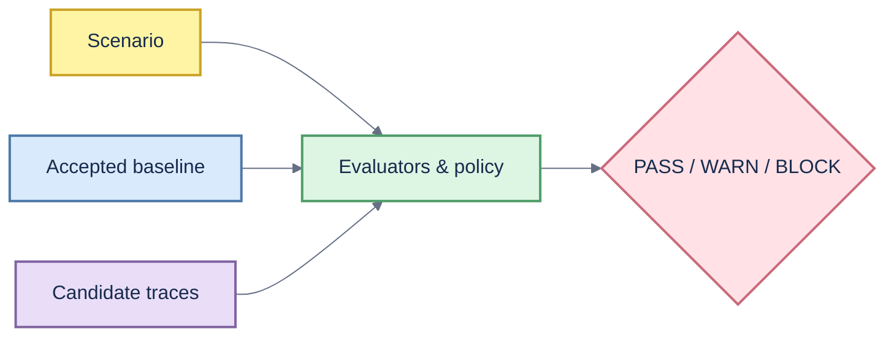

# RAGOps

Offline, reproducible release gates for RAG systems and AI agents.



Use it from Claude Code or Cowork: `/plugin marketplace add thangldw/ragops`, then `/plugin install ragops@ragops` (or in one step on Claude Code 2.1.275 or later: `/plugin install ragops --marketplace thangldw/ragops`). Details: [docs/claude-plugin.md](docs/claude-plugin.md).

Product introduction: [thangldw.github.io/ragops/](https://thangldw.github.io/ragops/). Latest published release: [v2.7.1](https://github.com/thangldw/ragops/releases/tag/v2.7.1). Main may contain later source or documentation changes; they do not replace the published artifact or its recorded verification.

RAGOps compares recorded candidate behavior with an accepted baseline, applies a versioned release policy, and emits one canonical `PASS`, `WARN`, or `BLOCK` decision across JSON, Markdown, HTML, JUnit, SARIF, and GitHub Summary. The dependency-free core performs no network calls. Optional adapters import vendor exports; the API/workbench ships in the wheel through the `api` extra.

Requirements: Python 3.11+.

Current technical references: [architecture](docs/ARCHITECTURE.md), [contracts](docs/CONTRACTS.md), [governance](docs/governance.md), [operations](docs/OPERATIONS.md), [production loop](docs/production-loop.md), [counterfactual test](docs/counterfactual-test.md), [security](SECURITY.md), and [v2.7.1 release notes](docs/releases/v2.7.1.md).

The repository is also a skills-only plugin for ChatGPT, Codex, Claude Code and Cowork. It does not include a hosted MCP connector. See the [directory submission package](docs/submission/DIRECTORY_SUBMISSION.md), [privacy policy](PRIVACY.md), [terms](TERMS.md), and [support guidance](SUPPORT.md).

```bash
pip install ragops
ragops demo --profile engineer --output ./demo-output
ragops evidence verify --bundle ./demo-output/evidence
open ./demo-output/release-report.html
```

On Windows PowerShell, replace the final command with
`Start-Process ./demo-output/release-report.html`.

The credential-free demo intentionally returns `BLOCK`: citation coverage `1.0 -> 0.5`, citation precision `1.0 -> 0.5`, and lexical groundedness `1.0 -> 0.6`. It is synthetic benchmark evidence, not production adoption evidence.

Install `ragops[api]` and run `ragops serve` for the local authenticated API/workbench. Use `ragops adapter list` for Phoenix, Ragas, DeepEval, LangSmith, MLflow, Promptfoo, custom JSON, and installed entry-point adapters.

Does the answer really come from the evidence? `ragops counterfactual --scenario s.json --responses r.json --answer-command "python my_app.py"` removes the supporting passages and swaps the numbers, asks your system again and flags answers that do not react ([how it works and its limits](docs/counterfactual-test.md)). To check the checks on your own scenario first, run `ragops counterfactual-selftest --scenario s.json --responses r.json`: it reports per perturbation whether an evidence-copying reference is left alone and a failing system is caught (`valid`, `weak` or `too_few_cases`).

Not sure the scorer is right? `ragops calibrate --target-accuracy 0.9` finds, from your own human labels, how far from the threshold a score must be to be trusted, and `ragops triage` then auto-decides those cases and queues only the uncertain ones for a person.

Is the same question answered differently on each run? `ragops collect-runs` records repeats, then `ragops stability --bundle runs.json --baseline-bundle old-runs.json --max-stddev-increase 0.05` blocks a candidate that became less repeatable even if its average score did not change.

Found a bad answer in production? `ragops mine --from logs.jsonl --scenario scenario.json --responses responses.json --output next/` adds every thumbs-down, low-rating or escalated log to the scenario as a regression case, so the suite grows with each incident.

No release policy yet? `ragops policy-suggest --scenario scenario.json --baseline responses.json --output policy.toml` generates a slice-aware policy v2 from your accepted baseline (review it before use), which `ragops gate-v2` then applies.

`lexical_groundedness` is a transparent lexical-overlap baseline, not a semantic judge: a correct paraphrase can score low and a wrong answer that reuses evidence vocabulary can score high. Japanese/Chinese text is compared as character bigrams and Vietnamese is NFC-normalized. For a stricter deterministic check (claim-level, exact numbers, negation) use `--evaluator strict_grounding`; measured accuracy and known failures are in [evaluator accuracy](docs/evaluator-accuracy.md). For semantic grounding, import Ragas/DeepEval scores through the adapters and calibrate against human labels.

Local CLI usage evidence is disabled by default. Set `RAGOPS_USAGE_LOG` to an explicit JSONL path to record only the UTC timestamp, RAGOps version, top-level command, and exit code; arguments and file paths are never recorded. Summarize the file with `ragops usage-report --events usage.jsonl`. Use the consent-aware `pilot-report` contract and the [production pilot runbook](docs/gtm/production-pilot.md) for production adoption evidence.

Released under the [Apache License 2.0](LICENSE).
