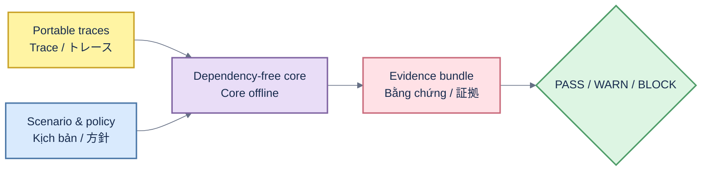

# RAGOps architecture / Kiến trúc / アーキテクチャ

## English

`src/ragops/` owns portable contracts, deterministic evaluators, slice/distribution analysis, policy decisions, calibration, evidence bundles, adapters, and SQLite governance. `src/ragops/api/` and `src/ragops/web/` are optional packaged adapters; importing the core never imports FastAPI, Uvicorn, or vendor SDKs. `apps/api/main.py` is a source compatibility shim. CLI/API/UI and CI renderers consume the same canonical decision evidence.

The production-loop modules sit beside the gate and reuse the same contracts: `policy_suggest.py` drafts a policy from a baseline, `calibration.py` and `triage.py` decide where the scorer can be trusted, `stability.py` compares repeated runs of a replay bundle, `mine.py` turns flagged production logs into scenario cases, and `counterfactual.py` alters evidence and re-asks a user-supplied command (with a self-test of its own checks). Each is an offline command that reads and writes JSON/TOML files; none imports a network client. See [production-loop.md](production-loop.md) and [counterfactual-test.md](counterfactual-test.md).

## Tiếng Việt

`src/ragops/` quản lý contract portable, evaluator xác định, policy, calibration, evidence bundle, adapter và SQLite governance. API/UI chỉ là adapter đóng gói tùy chọn; import core không import FastAPI/Uvicorn/vendor SDK. CLI/API/UI/CI dùng cùng canonical decision.

Các module vòng lặp production nằm cạnh cổng và dùng chung contract: `policy_suggest.py` (policy từ baseline), `calibration.py` + `triage.py` (chỗ nào tin được scorer), `stability.py` (so các lần chạy lặp), `mine.py` (log bị đánh dấu thành case) và `counterfactual.py` (đổi bằng chứng rồi hỏi lại, kèm self-test). Tất cả chạy offline, đọc/ghi file JSON/TOML, không import client mạng. Xem [production-loop.md](production-loop.md).

## 日本語

`src/ragops/` は portable contract、決定的 evaluator、policy、calibration、evidence bundle、adapter、SQLite governance を担当します。API/UI は任意の packaged adapter で、core import は FastAPI、Uvicorn、vendor SDK を読み込みません。CLI/API/UI/CI は同じ canonical decision を使用します。

本番運用ループのモジュールはゲートの隣にあり、同じ contract を使います: `policy_suggest.py`（ベースラインから方針）、`calibration.py` と `triage.py`（スコアラーを信頼できる範囲）、`stability.py`（繰り返し実行の比較）、`mine.py`（フラグ付きログをケース化）、`counterfactual.py`（根拠を変えて再質問、self-test 付き）。すべてオフラインで JSON/TOML を読み書きし、ネットワーククライアントは import しません。[production-loop.md](production-loop.md) を参照。
