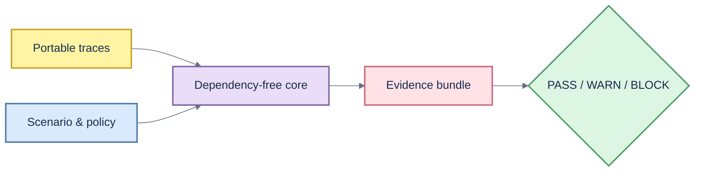

# RAGOps architecture

`src/ragops/` owns portable contracts, deterministic evaluators, slice/distribution analysis, policy decisions, calibration, evidence bundles, adapters, and SQLite governance. `src/ragops/api/` and `src/ragops/web/` are optional packaged adapters; importing the core never imports FastAPI, Uvicorn, or vendor SDKs. `apps/api/main.py` is a source compatibility shim. CLI/API/UI and CI renderers consume the same canonical decision evidence.

The production-loop modules sit beside the gate and reuse the same contracts: `policy_suggest.py` drafts a policy from a baseline, `calibration.py` and `triage.py` decide where the scorer can be trusted, `stability.py` compares repeated runs of a replay bundle, `mine.py` turns flagged production logs into scenario cases, and `counterfactual.py` alters evidence and re-asks a user-supplied command (with a self-test of its own checks). Each is an offline command that reads and writes JSON/TOML files; none imports a network client. See [production-loop.md](production-loop.md) and [counterfactual-test.md](counterfactual-test.md).
