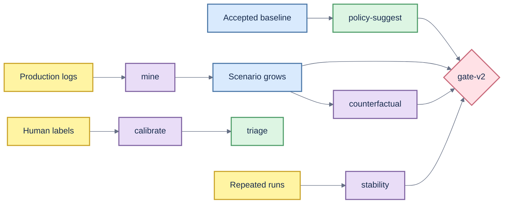

# Production loop

Five commands that connect real usage to the release gate: set a policy from a baseline, trust the
scorer only where it is accurate, catch unstable answers, grow the test set from production
failures, and test whether answers depend on their evidence. Every command is offline, makes no
network calls and needs no model provider (`counterfactual` calls only the command you give it).



### What was measured, and what was not

These tools were exercised on toy systems and on data constructed for the tests and demos. None has
been measured on a real production RAG system. Treat their output as a way to look at your own data
more carefully, not as a certificate. Where a section says "limits", read it.

### `policy-suggest`: a first policy from an accepted baseline

```bash
ragops policy-suggest --scenario scenario.json --baseline responses.json --output policy.toml
```

Writes a release policy v2 (TOML) with one slice per language, category and severity value that has
at least `--min-cases` cases (default 3) and does not cover the whole scenario. Each quality minimum
is the lowest baseline value among the whole set and the included slices, minus `--margin`
(default 0.05). So the baseline passes its own policy and a drop of more than the margin is blocked.
Review the file before use, then apply it with `ragops gate-v2`.

Limits: thresholds come from one baseline; they say "no worse than the accepted state", not "good".

### `calibrate` and `triage`: trust the scorer only where it agrees with people

```bash
ragops calibrate --input calibration.json --target-accuracy 0.9 --output calibration-report.json
ragops evaluate ... --format json > eval.json
ragops triage --evaluation eval.json --calibration calibration-report.json
```

`calibrate` compares automated scores with your human labels. It reports agreement, a
`suggested_threshold` (the pass threshold with the best accuracy among those within the false-pass
limit; ties go to the one closest to the current threshold) and a `confidence_band`: the narrowest
margin around the threshold outside of which the scorer agrees with your labels at
`--target-accuracy` (default 0.9, at least `--minimum-decided` cases, default 5). Exit code 0 on
`PASS`, 2 otherwise.

`triage` then sorts each case of an evaluation (`--metric`, default `lexical_groundedness`) into
`auto-pass`, `auto-fail` or `needs-review`: a score closer to the threshold than the margin goes to a
person; the rest are decided automatically and the report states the measured agreement on that
part. Exit code 0.

Limits: the band is only as good as the number and the spread of your labels; with few labels it can
be wide or absent, and then everything needs review.

### `stability`: the same question, answered differently each time

```bash
ragops collect-runs ...            # repeats each case and writes a replay bundle
ragops stability --bundle runs.json --baseline-bundle old-runs.json --max-stddev-increase 0.05
```

A case is unstable when a metric varies by more than `--max-range` (default 0.2) between repeats.
At most `--max-unstable-fraction` (default 0.1) of cases may be unstable. With `--baseline-bundle` and
`--max-stddev-increase`, a candidate whose mean per-case standard deviation grew by more than that
is blocked even if its average score did not move. `--metric` (repeatable) limits the metrics;
`--format json|markdown`. Exit code 0 on pass, 2 on `BLOCK`.

Limits: needs several repeats per case; a model that is deterministic at your settings always
passes.

### `mine`: grow the scenario from production failures

```bash
ragops mine --from logs.jsonl --scenario scenario.json --responses responses.json --output next/
```

Reads a JSON/JSONL file or a directory of logs and appends every flagged record (thumbs down,
rating at or below `--max-rating` (default 2), escalated, flagged, needs review) to the scenario as a
high-severity `mined-feedback` case. The failing answer is kept as that case's baseline response, so
a fixed system should beat it and the case guards against the failure returning. Questions already
in the scenario are skipped and the command refuses to overwrite existing output. It writes
`scenario.json`, `responses.json` and `mined.json` into `--output` and prints what was added or
skipped.

Limits: logs must contain the question, the answer and the evidence or citations; a flagged record
without them is reported as unusable. A thumbs-down is a signal, not proof the answer was wrong.

### `counterfactual` and `counterfactual-selftest`: do answers depend on the evidence?

```bash
ragops counterfactual --scenario s.json --responses r.json --answer-command "python my_app.py"
ragops counterfactual-selftest --scenario s.json --responses r.json
```

`counterfactual` changes the evidence (removes the supporting passages, swaps numbers, drops one
citation, plants an instruction, removes all evidence) and asks your own system again; it blocks when
too many answers ignore the change. `counterfactual-selftest` checks these checks on your own
scenario first: an evidence-copying reference should be left alone and an evidence-ignoring or
instruction-obeying system should be caught. Exit codes: counterfactual 0 PASS / 2 BLOCK /
3 INCONCLUSIVE; self-test 0 VALID / 2 WEAK / 3 INCONCLUSIVE. Full description, options and limits:
[counterfactual-test.md](counterfactual-test.md).

### How they fit together

1. Accept a baseline; `policy-suggest` drafts the policy; review it.
2. `calibrate` against a sample of human labels; `triage` the evaluations so people review only the
   uncertain cases.
3. In CI, run `gate-v2` and `stability`; run `counterfactual` when answers must be grounded.
4. After each incident, `mine` the flagged logs into the scenario so it cannot recur silently.
